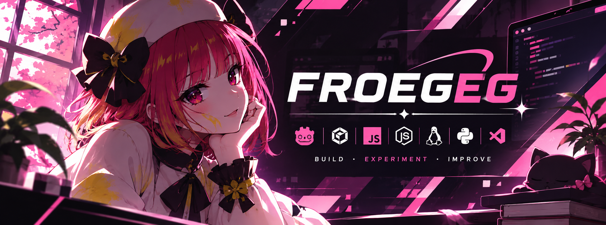

 

 

---

## **BUILD · EXPERIMENT · IMPROVE**

I enjoy building things, exploring unfamiliar technologies, and experimenting with ideas that turn into actual projects.

From applications and automation to game systems, low-level Android development, and reverse engineering — I'm interested in understanding how things work and seeing how far I can take them.

## `01` / WHAT I EXPLORE

| FIELD | INTEREST |
|:--|:--|
| `01` Software | Applications, architecture, full-stack systems |
| `02` Automation | Bots, integrations, APIs, real-time communication |
| `03` Game Tech | Godot, modular systems, game mechanics |
| `04` Systems | Linux, Android kernels, internals |
| `05` Research | Reverse engineering, experimentation |
| `06` Graphics | WebGL, shaders, audio-reactive visuals |

## `02` / SELECTED PROJECTS

### `01` — Godot Modular Inventory

**An open-source modular inventory addon for Godot.**

Reusable inventory architecture designed to work across different game genres, with modularity and extensibility in mind.

`GODOT` `GDSCRIPT` `OPEN SOURCE`

### `02` — Luminaris

**Modular WhatsApp automation.**

A plugin-oriented bot ecosystem with games, utilities, moderation, media tools and integrations.

`TYPESCRIPT` `BUN` `NODE.JS` `BAILEYS`

### `03` — Timi

**Private real-time messaging.**

A custom messaging application exploring socket communication, message synchronization, local caching and private conversations.

`REACT NATIVE` `EXPRESS` `SOCKET.IO` `SQLITE`

### `04` — Flow Mode

**Experimental audio visualization.**

A visual experience combining music, audio analysis, particles and real-time graphics.

`THREE.JS` `WEBGL` `WEB AUDIO`

<!-- <a href="https://github.com/froegeg?tab=repositories">EXPLORE ALL PROJECTS →</a> -->

## `03` / TECHNOLOGIES

**LANGUAGES & RUNTIMES**

**WEB & APPLICATIONS**

**GAME DEVELOPMENT**

**SYSTEMS & ENVIRONMENT**

05 / CONTRIBUTION FIELD — ACTIVITY

# Activity visualization.

 

 

---

---

## `05` / BEYOND CODE

 

### MAKE SOMETHING. BREAK SOMETHING. MAKE IT BETTER.

`FROEGEG` · `alvlp`

 

